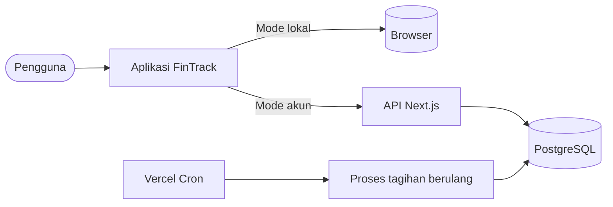

<div align="center">


# FinTrack Web

**Catat uang masuk. Pantau uang keluar. Kendalikan anggaran.**

Aplikasi keuangan pribadi berbahasa Indonesia untuk ponsel dan desktop.

[](https://github.com/Reliaaaa/FinTrack-Web/actions/workflows/client-build.yml) [](LICENSE)


<a href="https://fintrack-web671.vercel.app/?mode=lokal"></a>
<a href="https://fintrack-web671.vercel.app/login"></a>

[Fitur](#-fitur) · [Tampilan](#-tampilan) · [Cara pakai](#-cara-pakai) · [Instalasi](#-jalankan-di-komputer) · [Dokumentasi](#-dokumentasi)

</div>

## ✨ Fitur

<table>
<tr>
<td width="50%" valign="top">

### 📊 Dasbor
Lihat kekayaan bersih, saldo uang digital dan tunai, pemasukan, pengeluaran, sisa anggaran, tagihan berikutnya, dan arus kas 6 bulan.

</td>
<td width="50%" valign="top">

### 💸 Transaksi
Catat pemasukan, pengeluaran, dan transfer. Cari dan saring data. Lampirkan foto struk hingga 1 MB.

</td>
</tr>
<tr>
<td width="50%" valign="top">

### 👛 Dompet
Pisahkan saldo rekening bank, e-wallet, tunai, dan kartu kredit. Arsipkan dompet yang tidak dipakai.

</td>
<td width="50%" valign="top">

### 🎯 Anggaran
Atur batas per bulan atau per rentang tanggal, misalnya 30 hari, dengan judul sendiri. Status berubah saat pemakaian mencapai 80% dan 100%.

</td>
</tr>
<tr>
<td width="50%" valign="top">

### 🔁 Tagihan Berulang
Buat jadwal mingguan, bulanan, atau tahunan. Unduh file `.ics` untuk kalender kamu. Mode akun mendukung pencatatan otomatis jika server dan cron sudah dikonfigurasi.

</td>
<td width="50%" valign="top">

### 📈 Laporan
Bandingkan pengeluaran dengan bulan lalu. Lihat 5 pengeluaran terbesar. Unduh CSV berkolom rapi atau Excel dengan lembar Ringkasan dan Transaksi. Simpan laporan PDF A4 lewat dialog cetak.

</td>
</tr>
</table>

### 🏦 Investasi dan Simpanan

Sisihkan dana dari rekening, e-wallet, atau dompet tunai ke simpanan terpisah. Catat penarikan kembali ke dompet saat dibutuhkan. Dana simpanan tetap dihitung dalam kekayaan bersih.

🌗 Tersedia tema terang dan gelap.

## 📱 Tampilan

Dasbor terbaru memakai lebar layar penuh. Navigasi berada di dock kaca transparan yang mengambang di bawah. Dock mengikuti tema terang dan gelap serta menandai halaman aktif.

| Layar | Akses dari dock |
| --- | --- |
| Desktop | Delapan menu dan tombol **Tambah** untuk mencatat transaksi. |
| Ponsel dan tablet hingga 800 px | Dasbor, Transaksi, Anggaran, Investasi, dan Dompet. Buka **Lainnya** untuk Tagihan Berulang, Laporan, Pengaturan, dan panduan. Tombol tambah mengambang di atas dock. |

[Buka dasbor terbaru tanpa akun](https://fintrack-web671.vercel.app/?mode=lokal)

## 🧭 Cara pakai

| | 💻 Mode lokal | ☁️ Mode akun |
| --- | --- | --- |
| **Perlu daftar** | Tidak | Ya |
| **Penyimpanan** | Browser | Server (PostgreSQL) |
| **Akses dari perangkat lain** | Tidak | Ya |
| **Tagihan berulang** | Jadwal dan file kalender | Pencatatan otomatis dengan cron |
| **Mulai** | [Buka mode lokal](https://fintrack-web671.vercel.app/?mode=lokal) | [Daftar akun](https://fintrack-web671.vercel.app/login) |

> [!IMPORTANT]
> Data mode lokal hilang jika kamu membersihkan data browser. Ekspor CSV sebelum berganti perangkat. CSV berisi transaksi saja.

**3 langkah pertama:**

1. Tambahkan atau sesuaikan dompet dan saldo awal.
2. Catat transaksi.
3. Atur anggaran bulanan.

## 🛠️ Teknologi

| Bagian | Teknologi |
| --- | --- |
| Antarmuka | Next.js 15, React 19, TypeScript, CSS, Recharts, Lucide |
| Server | Next.js Route Handlers, Zod, bcryptjs |
| Data | PostgreSQL atau penyimpanan browser |
| Pengujian | Node test runner, Playwright |
| Otomasi | GitHub Actions, Vercel Cron |



## 🚀 Jalankan di komputer

Siapkan **Node.js 22**.

```bash
git clone https://github.com/Reliaaaa/FinTrack-Web.git
cd FinTrack-Web
npm ci
npm run dev
```

Buka [localhost:3000](http://localhost:3000). Aplikasi berjalan dengan penyimpanan browser jika `DATABASE_URL` kosong.

<details>
<summary><b>🗄️ Aktifkan akun dengan PostgreSQL</b></summary>

<br>

1. Jalankan `docker compose up -d`.
2. Salin `.env.example` ke `.env.local`.
3. Isi `DATABASE_URL` sesuai kredensial di [docker-compose.yml](docker-compose.yml).
4. Jalankan ulang `npm run dev`.

</details>

<details>
<summary><b>⚙️ Konfigurasi deployment</b></summary>

<br>

| Variabel | Fungsi |
| --- | --- |
| `DATABASE_URL` | Akun dan penyimpanan server |
| `CRON_SECRET` | Mengamankan cron transaksi berulang (harian, 08.00 WIB) |
| `APP_URL` | URL publik untuk Google OAuth dan pemulihan kata sandi |
| `GOOGLE_CLIENT_ID`, `GOOGLE_CLIENT_SECRET` | Login Google (opsional) |
| `RESEND_API_KEY`, `RESET_FROM_EMAIL` | Email pemulihan kata sandi (opsional) |

- **Google OAuth:** daftarkan callback `APP_URL/api/v1/auth/google/callback`. Akun kata sandi yang sudah ada tidak otomatis tertaut ke Google.
- **Pemulihan kata sandi:** gunakan pengirim terverifikasi dan matikan pelacakan klik di Resend. Tautan berlaku 30 menit untuk sekali pakai.

Baca [panduan deployment dan rollback](docs/08-devops.md). Cek [status layanan produksi](https://fintrack-web671.vercel.app/api/v1/health).

</details>

### 🧪 Pengujian

```bash
npm run typecheck
npm test
npx playwright install chromium
npm run test:ui
npm run build
```

## Kontribusi

Punya saran, menemukan bug, atau ingin menyumbang kode? [Cek issue yang sudah ada](https://github.com/Reliaaaa/FinTrack-Web/issues). Kalau topiknya sudah dibahas, tambahkan konteks di issue tersebut. Kalau belum, [buat issue baru](https://github.com/Reliaaaa/FinTrack-Web/issues/new) dengan judul yang spesifik.

- **Laporkan bug.** Sebutkan halaman, langkah untuk mengulang masalah, hasil yang kamu harapkan, dan hasil yang muncul. Tambahkan browser atau perangkat jika relevan. Gunakan data contoh jika menyertakan tangkapan layar.
- **Usulkan fitur atau perbaikan.** Jelaskan masalah yang kamu alami, perubahan yang kamu usulkan, dan contoh cara fitur itu dipakai.
- **Usulkan perubahan kode.** Jelaskan bagian yang kamu ubah dan cara mengujinya. Sertakan cuplikan kode, tautan commit, atau tautan branch di fork kamu agar pengelola bisa meninjaunya.

### Alur rilis untuk pengelola

Commit dan push ke branch permanen `feature`. Setelah pemeriksaan lulus, gabungkan lewat pull request `feature` → `dev`, lalu `dev` → `main` untuk rilis produksi. [Panduan branch dan rilis](docs/08-devops.md#branch-dan-gate-rilis)

## 📚 Dokumentasi

| Produk dan desain | Teknis | Kualitas |
| --- | --- | --- |
| [Fitur](docs/01-features.md) | [Arsitektur](docs/02-architecture.md) | [Laporan QA](docs/06-qa-report.md) |
| [PRD](docs/reference/PRD.md) | [API](docs/04-api.md) | [Keamanan](docs/07-security.md) |
| [Panduan desain](docs/03-design.md) | [Basis data](docs/05-database.md) | [Catatan tinjauan](docs/09-review.md) |
| [Spesifikasi UI/UX](docs/reference/UI-UX-Stitch.md) | [DevOps](docs/08-devops.md) | |
| [Ekspor Google Stitch](docs/stitch/) | [Prompt pengembangan awal](docs/reference/Codex-master-prompt.md) | |
| [Panduan UI/UX untuk Codex](docs/10-uiux-codex.md) | | |

## Lisensi

[MIT](LICENSE)

---

<div align="center">

Dibuat oleh [**Reliaaaa**](https://github.com/Reliaaaa)

⭐ Beri bintang jika FinTrack membantu kamu.

</div>
