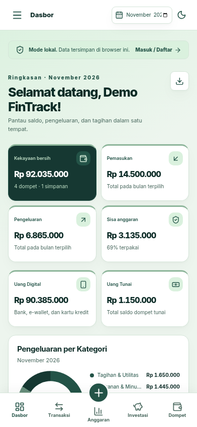

<p align="center">
  
</p>

<h1 align="center">FinTrack Web</h1>

<p align="center">
  Catat transaksi, kelola anggaran, dan pantau arus kas dalam satu dasbor keuangan pribadi.
</p>

<p align="center">
  <a href="https://fintrack-web-amber-ten.vercel.app"></a>
</p>

<p align="center">
  <a href="https://fintrack-web-amber-ten.vercel.app/login">Masuk atau daftar</a>
  ·
  <a href="https://fintrack-web-amber-ten.vercel.app/?mode=lokal">Gunakan tanpa akun</a>
</p>


<sub>Pratinjau dasbor menggunakan data contoh.</sub>

<details>
  <summary>Lihat tampilan seluler</summary>
  <br>
  
</details>

## Fitur utama

| Fitur | Yang bisa kamu lakukan |
| --- | --- |
| **Ringkasan keuangan** | Pantau kekayaan bersih, pemasukan, pengeluaran, sisa anggaran, dan grafik arus kas enam bulan. |
| **Uang digital dan tunai** | Lihat saldo bank, e-wallet, dan kartu kredit di kartu Uang Digital serta saldo dompet tunai di kartu Uang Tunai. Dana simpanan tetap dihitung dalam kekayaan bersih. |
| **Transaksi dan dompet** | Catat pemasukan, pengeluaran, serta transfer antar-dompet. Cari transaksi dan tambahkan foto struk. |
| **Investasi dan simpanan** | Sisihkan dana dari rekening, e-wallet, atau dompet tunai ke simpanan terpisah. Catat penarikan kembali ke dompet saat dibutuhkan. |
| **Anggaran bulanan** | Tetapkan batas belanja per kategori dan lihat berapa banyak yang sudah terpakai. |
| **Tagihan berulang** | Jadwalkan pemasukan atau tagihan rutin. Unduh kalender `.ics` untuk diimpor ke Google Calendar. |
| **Laporan** | Saring transaksi, unduh CSV atau Excel, dan simpan PDF lewat dialog cetak. |
| **Tema dan tampilan** | Gunakan FinTrack di ponsel atau desktop dalam tema terang dan gelap. |

## Mulai menggunakan FinTrack

- **Dengan akun.** Daftar dengan email dan kata sandi untuk menyimpan catatan di server dan membukanya dari perangkat lain. Akun baru memiliki satu dompet Tunai dengan saldo awal Rp0. [Daftar atau masuk](https://fintrack-web-amber-ten.vercel.app/login)
- **Tanpa akun.** Mulai mencatat dengan penyimpanan browser. Ekspor catatan sebelum membersihkan data browser atau berganti perangkat. [Buka mode lokal](https://fintrack-web-amber-ten.vercel.app/?mode=lokal)

## Pengembangan lokal

FinTrack menggunakan Next.js 15, React 19, TypeScript, PostgreSQL, dan Recharts. GitHub Actions menjalankan pemeriksaan aplikasi, termasuk pengujian Chromium dan integrasi PostgreSQL.

Gunakan Node.js 22, lalu jalankan perintah berikut dari folder repo.

```bash
npm ci
npm run dev
```

Buka [localhost:3000](http://localhost:3000). Tanpa `DATABASE_URL`, aplikasi bisa digunakan dengan penyimpanan browser. Untuk menguji akun dan penyimpanan server, jalankan PostgreSQL lokal dengan `docker compose up -d`, salin `.env.example` ke `.env.local`, lalu atur `DATABASE_URL` sesuai kredensial pengembangan di [docker-compose.yml](docker-compose.yml).

```bash
npm run typecheck
npm test
npx playwright install chromium
npm run test:ui
npm run build
```

<details>
  <summary>Konfigurasi deployment dan akun</summary>

  - Atur `DATABASE_URL` untuk akun dan penyimpanan server. Atur `CRON_SECRET` agar Vercel Cron dapat mencatat transaksi berulang setiap hari pukul 08.00 WIB.
  - Atur `APP_URL` ke URL publik jika menggunakan Google OAuth atau email pemulihan kata sandi.
  - Untuk Google OAuth, daftarkan URL callback `APP_URL/api/v1/auth/google/callback`, lalu isi `GOOGLE_CLIENT_ID` dan `GOOGLE_CLIENT_SECRET`. Akun kata sandi yang sudah terdaftar tidak otomatis tertaut ke Google.
  - Untuk pemulihan kata sandi, isi `RESEND_API_KEY` dan `RESET_FROM_EMAIL` dengan pengirim terverifikasi. Nonaktifkan pelacakan klik di Resend agar tautan pemulihan tidak ditulis ulang. Tautan berlaku 30 menit dan hanya bisa digunakan sekali.

  Lihat [panduan deployment dan rollback](docs/08-devops.md) serta [status layanan produksi](https://fintrack-web-amber-ten.vercel.app/api/v1/health).
</details>

## Dokumentasi proyek

- [Fitur](docs/01-features.md) dan [spesifikasi produk](docs/reference/PRD.md)
- [Panduan desain](docs/03-design.md), [spesifikasi UI/UX](docs/reference/UI-UX-Stitch.md), dan [ekspor Google Stitch](docs/stitch/)
- [Arsitektur](docs/02-architecture.md), [API](docs/04-api.md), dan [basis data](docs/05-database.md)
- [Laporan QA](docs/06-qa-report.md), [keamanan](docs/07-security.md), dan [catatan tinjauan](docs/09-review.md)
- [Prompt pengembangan awal](docs/reference/Codex-master-prompt.md)
