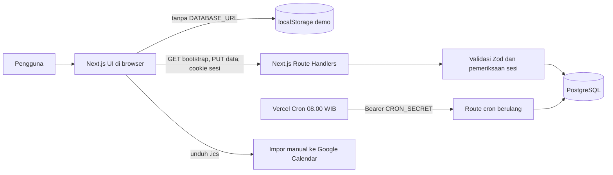

# Arsitektur FinTrack Web

Dokumen ini mencatat **implementasi yang ada** pada 16 November 2026. Cakupan dan pekerjaan berikutnya ada di [backlog](01-features.md); arsitektur target dari PRD tetap ada di [dokumen asal](reference/PRD.md).

## Alur data

1. Browser memanggil `/api/v1/bootstrap`. Tanpa `DATABASE_URL`, UI memakai data contoh dan menyimpan perubahan di `localStorage` (`fintrack-demo-v1`). Data demo tidak menjadi data akun dan tidak tersinkron.
2. Dengan database, bootstrap memerlukan cookie sesi dan mengembalikan snapshot beserta `version`. Registrasi/login membuat sesi. UI mengirim `{version, data: {name, wallets, entries, budgets, recurring}}` melalui `PUT /api/v1/data`. Server memvalidasi bentuk data dan hubungan ID dompet, lalu memperbarui JSONB milik `user_id` dari sesi hanya jika nomor versi cocok. Versi naik pada setiap penulisan. Ketika versi usang, API mengembalikan HTTP 409; UI menyimpan perubahan sebagai draf `sessionStorage` dan menawarkan unduhan draf serta pemuatan data server terbaru.
3. Saldo dompet **dihitung** dari saldo awal dan seluruh transaksi, bukan disalin sebagai nilai kedua. Transfer mengurangi dompet asal dan menambah dompet tujuan; total kekayaan tidak berubah.
4. Route cron membaca jadwal aktif, mengunci baris `finance_data` dengan `FOR UPDATE`, membuat ID transaksi deterministik per jadwal/tanggal, memajukan `nextDate`, lalu menaikkan `version`. Ini mencegah dua eksekusi cron membuat transaksi yang sama dan membuat snapshot tab lama menghasilkan konflik 409. Pengguna demo hanya mendapat pengingat dan file `.ics` untuk impor manual ke kalender.

## Struktur modul dan batas tanggung jawab

| Lokasi | Tanggung jawab | Batas |
| --- | --- | --- |
| `src/app/page.tsx`, `src/app/[section]/page.tsx` | Entry point dasbor dan deep link halaman | Tidak menghitung saldo atau mengakses database. |
| `src/components/FinanceApp.tsx` | App shell, halaman, form, state UI, pemanggilan bootstrap/data | Saat ini satu komponen besar; sebaiknya dipecah menurut halaman sebelum ekspansi P1/P2. |
| `src/app/globals.css` | Token warna, layout, state, responsivitas, reduced motion | Gaya tidak disimpan pada server. |
| `src/lib/finance.ts` | Tipe data, data demo, saldo, periode, tanggal berulang | Fungsi tanpa I/O; dipakai UI dan cron. |
| `src/lib/metrics.ts`, `format.ts`, `export.ts` | Metrik grafik, format Rupiah/tanggal, ekspor CSV/XLSX/ICS | Metrik dibentuk dari snapshot saat ini. Ekspor berjalan di browser. |
| `src/app/api/v1/*/route.ts` | Boundary HTTP untuk auth, bootstrap, data, health | Tidak menerima `user_id` dari klien untuk akses data akun. |
| `src/server/auth.ts` | Sesi, cookie, pemeriksaan Origin, rate limit | Hanya untuk route server. |
| `src/server/validation.ts`, `body.ts` | Skema Zod snapshot dan pembacaan JSON dengan batas ukuran | Input browser dianggap tidak tepercaya. |
| `src/server/db.ts`, `migrations/` | Pool PostgreSQL, pembuatan skema idempoten, dan SQL migrasi manual | `001_initial.sql` adalah skema awal; `002_snapshot_version.sql` menambah versi pada database lama. Migrasi belum diuji pada PostgreSQL nyata. |
| `src/app/api/cron/recurring/route.ts` | Penjadwalan transaksi akun | Hanya aktif dengan database dan `CRON_SECRET`. |
| `public/`, `vercel.json` | Manifest, ikon, service worker, jadwal Vercel Cron | Service worker tidak meng-cache `/api/`. |
| `tests/` | Tes unit perhitungan keuangan dan alur UI browser | Tes integrasi PostgreSQL nyata belum lengkap. |

Nama TypeScript menggunakan `camelCase` untuk fungsi/variabel, `PascalCase` untuk komponen/tipe, dan nama route Next.js mengikuti segmen URL. Nominal disimpan sebagai angka rupiah tanpa sen; format mata uang hanya saat ditampilkan. Semua tanggal transaksi memakai string `YYYY-MM-DD`. Model satu mata uang IDR sesuai rilis sekarang.

## Library utama

Versi berikut adalah yang tercatat di `package.json` (rentang `^` dikunci lebih tepat oleh `package-lock.json`):

| Paket | Versi deklarasi | Pemakaian |
| --- | --- | --- |
| Next.js | `^15.5.29` | UI App Router, route handlers, build Vercel |
| React / React DOM | `^19.3.1` | Komponen dan state UI |
| TypeScript | `^5.9.3` | Pemeriksaan tipe |
| PostgreSQL `pg` | `^8.23.1` | Akses database berparameter |
| Zod | `^4.6.7` | Validasi input API |
| bcryptjs | `^3.0.3` | Hash kata sandi 12 rounds |
| Recharts | `^3.10.1` | Grafik arus kas dan laporan |
| Lucide React | `^1.73.0` | Ikon UI |
| JSZip | `^3.10.2` | Pembuatan XLSX di browser |
| tsx | `^4.23.15` | Menjalankan tes TypeScript dengan Node |

Tailwind, shadcn, TanStack Query, NestJS, Prisma, Redis, dan object storage yang disebut PRD **belum** digunakan. UI memakai CSS biasa dan satu aplikasi Next.js sehingga belum ada folder backend terpisah. Keputusan ini mengurangi kebutuhan layanan untuk demo, tetapi tidak menutup pekerjaan P0/P1 yang belum selesai.

## Keputusan dan risiko arsitektur

- **JSONB per pengguna:** penulisan snapshot atomik dengan compare-and-swap pada kolom `version`; konflik tab atau cron menghasilkan HTTP 409 dan draf lokal dapat diunduh. Konflik **belum digabung otomatis**. JSONB juga belum memberi indeks transaksi per tanggal/dompet atau paginasi server; untuk data besar, pindahkan entitas ke tabel relasional dengan operasi granular.
- **`localStorage` untuk demo:** tidak terenkripsi, terbatas pada satu browser, dan dapat hilang saat data browser dibersihkan. Jangan gunakan untuk keuangan nyata. UI memberi label mode demo; tidak ada migrasi otomatis dari demo ke akun.
- **Anggaran:** `Budget.period` menyimpan `YYYY-MM`; UI memilih pagu untuk bulan yang sedang ditampilkan dan menghindari duplikasi kategori dalam periode tersebut. Field ini opsional untuk kompatibilitas data demo lama; anggaran lama tanpa `period` diperlakukan sebagai anggaran bulan berjalan. Migrasi eksplisit data lama masih diperlukan sebelum akun produksi.
- **Skema:** `migrations/001_initial.sql` dan `002_snapshot_version.sql` tersedia; `ensureSchema()` juga membuat tabel dan menambahkan kolom versi secara idempoten. Uji migrasi serta backup/pemulihan pada PostgreSQL nyata belum selesai.
- **Autentikasi:** email/password tersedia di kode; Google OAuth dan reset lewat email belum ada. Kredensial penyedia dan alur akun perlu dirancang sebelum rilis P0 penuh.
- **Struk dan offline:** data URL struk tersimpan bersama JSONB, bukan object storage. Service worker meng-cache shell/statik; sinkronisasi ke server saat offline belum ada.

## Langkah menuju P0 lengkap

1. Uji registrasi, sesi, isolasi data, konflik versi, dan migrasi SQL dengan PostgreSQL nyata; pastikan backup dan pemulihan bekerja.
2. Tambahkan paginasi server dan indeks/filter transaksi pada model relasional. Filter tanggal/kategori browser dan anggaran per bulan sudah ada di kode, tetapi tetap perlu uji terhadap data akun.
3. Selesaikan Google OAuth, reset password, lalu uji seluruh boundary sesi.
4. Rancang penyelesaian konflik yang dapat menggabungkan perubahan aman. Saat memperbesar volume, pecah `finance_data` menjadi tabel dompet/transaksi/anggaran/jadwal dengan foreign key dan indeks.
5. Jalankan uji end-to-end dan pemeriksaan performa sebelum menandai P0 siap produksi.
